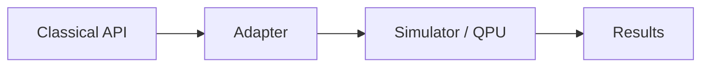

# Quantum Software Lab

Explore quantum gates, measurement, entanglement, and a simplified Grover search using **100% local simulation** (Qiskit + Aer). No IBM account, tokens, or real quantum hardware required.

## Learning Objectives

- Understand that a measurement does not return all possibilities of a superposition.
- Distinguish deterministic ideal results from probabilistic shot-based results.
- Practice writing tests for quantum circuits.
- Relate quantum execution to software engineering concerns (abstraction, reproducibility, hybrid architecture).

## Requirements

- Docker (recommended) **or** Python 3.11/3.12
- No external accounts or internet after the initial image build

## Quick Start with Docker (recommended)

```bash
# Build the image
docker build -t quantum-software-lab .

# Verify installation (demo mode works without completing challenges)
docker run --rm quantum-software-lab

# Interactive shell to work on challenges
docker run --rm -it -v $(pwd):/app quantum-software-lab bash

# Inside the container you can run:
python -m quantum_lab.demo
python challenges/challenge_01_superposition.py
pytest -q
```

## Manual Installation (alternative)

```bash
python -m venv .venv
source .venv/bin/activate          # Windows: .venv\Scripts\Activate.ps1
pip install -r requirements.txt
python -m quantum_lab.demo
```

## Repository Structure

| Path | Description |
|------|-------------|
| `src/quantum_lab/` | Shared simulator utilities |
| `challenges/` | Four guided challenges with TODOs |
| `tests/` | Public pytest suite |
| `docs/` | Concepts and teacher notes |
| `Dockerfile` | Containerized environment |

## Challenges

1. **Superposition** – Hadamard and double Hadamard
2. **Entanglement** – Bell pair
3. **Grover** – Educational 2-qubit search
4. **Testing** – Deterministic vs probabilistic assertions

Each challenge starts with a prediction, then TODOs to complete, then execution and reflection questions.

## Running Tests

```bash
pytest -q
```

Initial runs will fail until the TODOs are completed. This is expected.

## Development Workflow

This repository follows **Trunk-Based Development**:

- Work directly on the main branch (or short-lived feature branches that are merged quickly).
- Prefer small, frequent commits.
- Use **Conventional Commits**:
  - `feat: add Bell pair circuit`
  - `fix: correct diffusion operator`
  - `docs: update README Docker instructions`
  - `test: add probabilistic margin for H gate`

## Hypothetical Hybrid Architecture



## Glossary (no formulas)

- **Qubit**: Quantum bit that can be in superposition.
- **Hadamard (H)**: Gate that creates equal superposition.
- **Measurement**: Collapse to a classical outcome.
- **Entanglement**: Correlation that cannot be explained classically.
- **Oracle**: Black-box that marks the desired solution.
- **Shots**: Number of times the circuit is executed to estimate probabilities.

## Common Errors

- Missing measurements → empty or unexpected counts.
- Expecting exact 50/50 → use margins or statevector for deterministic checks.
- Import errors → ensure you are inside the container or have the package on PYTHONPATH.

## License

Apache 2.0. See [LICENSE](LICENSE).

---

Generated as an educational artifact. All simulation is local and ideal unless a noise model is explicitly added.
